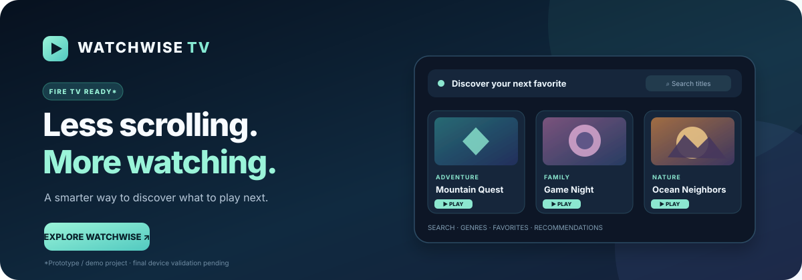
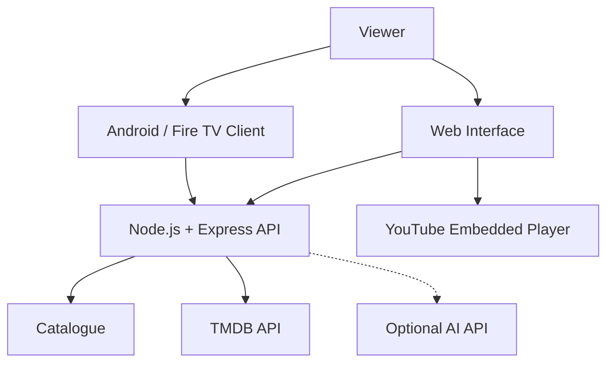

<!-- WatchWise TV | Project Showcase -->

<div align="center">



# 🎬 WATCHWISE TV

### Less scrolling. More watching.

**Your next favorite story starts here.**

Discover movies and series, explore trending shows, find trailers, and keep your watchlist close — all in one streamlined experience.

<br/>

<a href="https://watchwise-fire-tv.vercel.app/">
  
</a>

<br/><br/>


</div>

---

## ✨ About the Project

WatchWise TV is a streaming-discovery application designed to make finding something to watch easier. Browse titles, explore trending TV series, preview available trailers, and save favorites in one convenient interface.

The project combines a web-based discovery experience with a backend API and a native Android/Fire TV client.

## 🚀 Features

<table>
<tr>
<td width="50%">

### 🔥 Trending Series

Discover trending TV shows using TMDB data, including posters, ratings, release dates, and descriptions.

</td>
<td width="50%">

### ▶️ Trailer Playback

Find available YouTube trailers and play them using an embedded video player.

</td>
</tr>
<tr>
<td width="50%">

### 🔎 Search & Filters

Search titles and filter the catalogue by genre or industry.

</td>
<td width="50%">

### ❤️ Favorites

Save favorite titles locally in your browser for quick access.

</td>
</tr>
<tr>
<td width="50%">

### 🧠 Recommendations

Get suggestions based on preferences, with local fallback recommendations.

</td>
<td width="50%">

### 📺 Streaming Shortcuts

Open external streaming services directly from the discovery interface.

</td>
</tr>
</table>

## 🖼️ Visual Gallery

<div align="center">


**Illustrative entertainment imagery — not actual application screenshots.**

</div>

## 🧩 Architecture



## 🛠️ Tech Stack

| Component | Technology |
|---|---|
| Frontend | HTML, CSS, JavaScript |
| Backend | Node.js, Express |
| Middleware | Helmet, CORS |
| Trending data | TMDB API |
| Trailer playback | YouTube embedded player |
| TV client | Kotlin, Android, AndroidX Media3 |
| Deployment | Vercel |
| Automation | GitHub Actions |

## ⚙️ Getting Started

### Prerequisites

- Node.js 18 or newer
- npm
- TMDB API key for live trending-series and trailer functionality
- Optional AI-compatible API credentials

### 1. Clone the repository

```bash
git clone https://github.com/Mohitrath/watchwise-fire-tv.git
cd watchwise-fire-tv
```

### 2. Install backend dependencies

```bash
cd backend
npm install
```

### 3. Configure environment variables

Copy the example environment file:

```bash
cp .env.example .env
```

On Windows PowerShell:

```powershell
Copy-Item .env.example .env
```

Edit `backend/.env`:

```dotenv
TMDB_API_KEY=your_tmdb_api_key

# Optional AI configuration
AI_API_KEY=your_ai_api_key
# AI_BASE_URL=https://api.openai.com/v1
# AI_MODEL=gpt-4o-mini
```

**Security:** Never commit real API keys to GitHub.

### 4. Start the application

```bash
npm start
```

Open the browser at:

http://localhost:3000

## 🔌 API Reference

| Method | Endpoint | Description |
|---|---|---|
| GET | `/health` | Check backend health |
| GET | `/api/titles` | Retrieve catalogue titles |
| GET | `/api/titles/:id` | Retrieve a specific title |
| GET | `/api/genres` | Retrieve available genres |
| GET | `/api/trending-series` | Retrieve trending TV series |
| GET | `/api/trending-series/:id/trailer` | Look up a trailer |
| POST | `/api/recommendations` | Get recommendations |
| GET | `/api-info` | View API information |

### Test the API

```bash
curl http://localhost:3000/health
curl http://localhost:3000/api/titles
curl http://localhost:3000/api/trending-series
```

## 📁 Project Structure

```text
watchwise-fire-tv/
├── app/                         # Native Android / Fire TV client
├── backend/
│   ├── api/                     # Vercel serverless entry points
│   ├── public/
│   │   └── index.html           # Web interface
│   ├── src/
│   │   ├── server.js            # API routes
│   │   └── catalogue.js         # Sample catalogue
│   ├── .env.example
│   └── package.json
├── docs/
│   ├── screenshots/
│   ├── watchwise-banner.svg
│   └── fire-tv-demo-guide.md
├── .github/workflows/
├── LICENSE
└── README.md
```

## 🔐 Important Notes

- Live trending data requires valid TMDB API credentials.
- Some titles may not have available trailers.
- YouTube controls whether videos can be embedded.
- WatchWise embeds trailers instead of downloading or rehosting them.
- Streaming shortcuts open external provider websites.
- Recommendations can use a local fallback when AI credentials are unavailable.

## 🗺️ Roadmap

- [x] Catalogue search and filters
- [x] Favorites
- [x] Trending TV series
- [x] Trailer lookup and embedded playback
- [x] Local recommendation fallback
- [x] Add actual application screenshots
- [x] Add automated API tests
- [x] Verify playback on target Fire TV hardware

## 🤝 Contributing

Contributions and suggestions are welcome.

1. Fork the repository.
2. Create a feature branch.
3. Make and test your changes.
4. Submit a pull request with a clear description.

Please do not commit secrets, local environment files, or copyrighted media.

## 📄 License

This project is distributed under the [MIT License](LICENSE), subject to applicable third-party terms.

---

<div align="center">

### 🍿 Less scrolling. More watching.

**Discover something worth watching with WatchWise TV.**

<a href="https://watchwise-fire-tv.vercel.app/">
  🚀 Launch WatchWise TV
</a>

</div>
