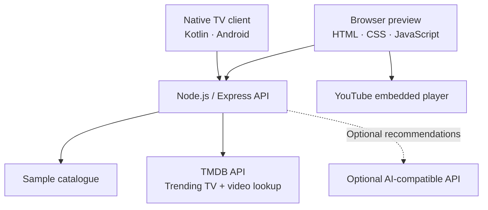

<!--
  WatchWise TV — project showcase
  Keep screenshot files in docs/screenshots/ and preserve these relative paths.
-->
<div align="center">


# WATCHWISE TV
### Less scrolling. More watching.

A streaming-discovery dashboard for finding what to watch, exploring trending series, saving favorites, and getting quick recommendations — with a browser preview and a native Fire TV / Android client.

<p>
  <a href="https://watchwise-fire-tv.vercel.app/"><strong>🚀 Open the live preview</strong></a>
  &nbsp; · &nbsp;
  <a href="#-screenshots">View screenshots</a>
  &nbsp; · &nbsp;
  <a href="#-run-locally">Run locally</a>
</p>

<p>
  
  
  
  
  
</p>

</div>

---

## ✦ The experience

WatchWise is designed to make choosing something to watch feel effortless. Browse a catalogue, filter by industry and genre, save favorites, explore live TV-series trends, and open available YouTube trailers without leaving the discovery flow.

### What you can do

| Feature | What it does |
|---|---|
| **Live trending series** | Fetches trending TV titles from TMDB, with posters, ratings, vote counts, release years, and short score analysis. |
| **Trailer playback** | Looks up available YouTube trailers and embeds them in the WatchWise player. Some titles may not have a trailer listed. |
| **Catalogue discovery** | Browse Movies and Series, search titles and descriptions, and filter by genre or movie industry. |
| **Favorites** | Save titles locally in the browser for quick return visits. |
| **Recommendations** | Get a short list based on genre and duration preferences. Local recommendations work without an AI key. |
| **Streaming shortcuts** | Open external streaming services; availability and playback remain controlled by each provider. |
| **Resilient demo mode** | The browser UI can fall back to sample content when the API cannot be reached. |

## 🖼️ Screenshots

The screenshots below document the current browser experience: the cinematic home screen, live trending-series cards, streaming-service shortcuts, and catalogue filters.

> **Screenshot assets:** Place the four supplied images in `docs/screenshots/` using the filenames below. The image links are intentionally repository-relative so they work on GitHub and in local clones once those files are committed.

<table>
  <tr>
    <td width="50%">
      <strong>01 · Home & discovery</strong><br/>
      
    </td>
    <td width="50%">
      <strong>02 · Trending series</strong><br/>
      
    </td>
  </tr>
  <tr>
    <td width="50%">
      <strong>03 · Streaming shortcuts</strong><br/>
      
    </td>
    <td width="50%">
      <strong>04 · Catalogue & filters</strong><br/>
      
    </td>
  </tr>
</table>

## 🧭 How it works



The browser calls the API on the same origin. TMDB provides trending series and associated video metadata; trailer playback uses YouTube's embedded player. The project does not download or rehost YouTube videos.

## 🧰 Tech stack

| Layer | Technology |
|---|---|
| Browser UI | HTML, CSS, JavaScript |
| Backend | Node.js 18+, Express |
| Security / middleware | Helmet, CORS |
| Trending titles and trailer metadata | TMDB API |
| Trailer playback | YouTube embedded player |
| Native TV client | Kotlin, Android, AndroidX Media3 |
| Deployment | Vercel configuration |
| CI | GitHub Actions Android build workflow |

## 🚀 Run locally

### Requirements

- Node.js 18 or newer
- npm
- A TMDB API key to enable live trending series and trailer lookup
- Optional AI-compatible API credentials for AI-assisted recommendations

### 1. Start the backend

```bash
cd backend
npm install
cp .env.example .env
npm start
```

On Windows PowerShell, copy the environment template with:

```powershell
Copy-Item .env.example .env
```

Set your keys in `backend/.env`:

```dotenv
TMDB_API_KEY=your_tmdb_api_key
# Optional:
AI_API_KEY=your_ai_api_key
# Optional overrides:
# AI_BASE_URL=https://api.openai.com/v1
# AI_MODEL=gpt-4o-mini
```

**Never commit real API keys.** Configure production secrets in Vercel Environment Variables, then redeploy.

### 2. Open the browser app

Visit [http://localhost:3000](http://localhost:3000).

Useful checks:

```bash
curl http://localhost:3000/health
curl http://localhost:3000/api/titles
curl http://localhost:3000/api/genres
curl http://localhost:3000/api/trending-series
```

Fetch a trailer for a series using its TMDB series ID:

```bash
curl http://localhost:3000/api/trending-series/SERIES_ID/trailer
```

Request recommendations:

```bash
curl -X POST http://localhost:3000/api/recommendations \
  -H "Content-Type: application/json" \
  -d '{"genres":["Family","Adventure"],"maxDurationMinutes":15,"language":"English"}'
```

### 3. Build the Android client

1. Install Android Studio and JDK 17.
2. Install the SDK platform and build tools required by the project.
3. Open the repository root in Android Studio and sync Gradle.
4. Build the debug variant or run `gradle assembleDebug` if Gradle is configured on your machine.
5. Test on the target Fire TV device or a suitable emulator. A successful generic Android build alone does not confirm Fire TV compatibility.

## 🔌 API reference

| Method | Endpoint | Purpose |
|---|---|---|
| `GET` | `/health` | Health status and AI configuration flag |
| `GET` | `/api/titles` | List catalogue titles; supports optional genre and text query filters |
| `GET` | `/api/titles/:id` | Fetch a catalogue title |
| `GET` | `/api/genres` | List genres |
| `GET` | `/api/trending-series` | Fetch trending TV series from TMDB |
| `GET` | `/api/trending-series/:id/trailer` | Look up a YouTube trailer for a TMDB series ID |
| `POST` | `/api/recommendations` | Return local or optional AI-assisted recommendations |
| `GET` | `/api-info` | Describe API endpoints |

For production, replace the local base URL with [https://watchwise-fire-tv.vercel.app](https://watchwise-fire-tv.vercel.app).

## 🔐 Configuration & notes

- Keep all provider credentials on the server, never in browser JavaScript or the native client.
- Trending data and trailer availability depend on TMDB metadata and API availability.
- YouTube controls whether a video can be embedded; not every video permits embedding.
- Streaming-service cards are external links, not integrated playback.
- Use official trailers and respect the rights and terms that apply to each provider.

## 🗂️ Repository layout

```text
watchwise-fire-tv/
├── app/                         # Native Android / Fire TV client
├── backend/
│   ├── api/                     # Vercel serverless entry points
│   ├── public/
│   │   └── index.html           # Browser preview
│   ├── src/
│   │   ├── server.js            # API routes
│   │   └── catalogue.js         # Sample catalogue
│   ├── .env.example
│   └── package.json
├── docs/
│   ├── screenshots/             # README screenshots
│   ├── watchwise-banner.svg
│   └── fire-tv-demo-guide.md
├── .github/workflows/
├── LICENSE
└── README.md
```

## 🛣️ Roadmap

- [x] Search, genre filters, and favorites
- [x] Trending TV-series section
- [x] YouTube trailer lookup and embedded playback
- [x] Local recommendation fallback
- [ ] Automated tests for API routes and player flows
- [ ] Verify all trailer buttons against live deployment
- [ ] Validate navigation and playback on target Fire TV hardware

## 🤝 Contributing

Issues and pull requests are welcome. Please include clear reproduction steps for bugs and avoid committing secrets, downloaded copyrighted media, build outputs, or local environment files.

## 📄 License

Distributed under the [MIT License](LICENSE), unless otherwise noted for third-party assets and services.

---

<div align="center">

**WatchWise TV** · Discover something worth watching.

<a href="https://watchwise-fire-tv.vercel.app/">Live preview ↗</a>

</div>
