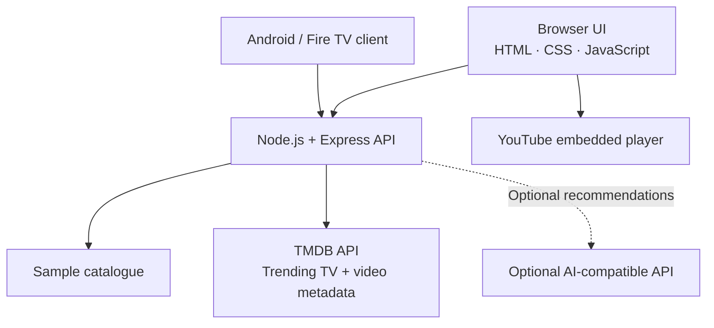

<!-- WatchWise TV — project README -->
<div align="center">


# WatchWise TV
### Less scrolling. More watching.

A TV-first discovery experience for exploring movies and series, finding trending shows, checking available trailers, and saving what you want to watch.

<p>
  <a href="https://watchwise-fire-tv.vercel.app/"><strong>🚀 Open the live preview</strong></a>
  &nbsp; · &nbsp;
  <a href="#features">Features</a>
  &nbsp; · &nbsp;
  <a href="#run-locally">Run locally</a>
</p>


</div>

---

## The idea

Finding something good to watch shouldn't mean endlessly scrolling. WatchWise brings discovery tools into one focused interface: explore a catalogue, narrow it down with filters, check trending TV series, and open available trailers from the same flow.

## Features

| Feature | Description |
|---|---|
| **Trending TV series** | Retrieves current trending TV titles from TMDB, including posters, ratings, dates, and descriptions. |
| **Trailer discovery** | Looks up trailer metadata and embeds available YouTube videos in the app. Not every title has a trailer available for embedding. |
| **Search and filters** | Search the catalogue and narrow titles by genre or industry. |
| **Favorites** | Save titles locally in the browser for quick access. |
| **Recommendations** | Get suggestions based on preferences; local fallback works without an AI API key. |
| **Streaming shortcuts** | Jump to external streaming services. Playback and regional availability are managed by each provider. |
| **Demo fallback** | Sample titles keep the browser interface useful if the API is unavailable. |

## Visual gallery

A cinematic moodboard for the WatchWise experience. These are illustrative movie-night visuals, **not screenshots of the live interface**.

<table>
  <tr>
    <td width="50%" align="center">
      <strong>01 · Settle in and discover</strong><br/>
      
      <sub>A cinema-inspired discovery experience.</sub>
    </td>
    <td width="50%" align="center">
      <strong>02 · Series night</strong><br/>
      
      <sub>Built around the big-screen viewing experience.</sub>
    </td>
  </tr>
  <tr>
    <td width="50%" align="center">
      <strong>03 · Your streaming corner</strong><br/>
      
      <sub>Keep discovery and streaming shortcuts together.</sub>
    </td>
    <td width="50%" align="center">
      <strong>04 · Movie mood</strong><br/>
      
      <sub>Find the next story worth watching.</sub>
    </td>
  </tr>
</table>

> These images are loaded from Unsplash via external URLs, so no image files need to be uploaded to this repository. Actual WatchWise UI screenshots can be added here later.

## Architecture



## Tech stack

- **Browser UI:** HTML, CSS, JavaScript
- **Backend:** Node.js 18+, Express
- **Middleware:** Helmet and CORS
- **Discovery metadata:** TMDB API
- **Trailer playback:** YouTube embedded player
- **TV client:** Kotlin, Android, AndroidX Media3
- **Deployment:** Vercel configuration
- **CI:** GitHub Actions Android build workflow

## Run locally

### Prerequisites

- Node.js 18 or newer
- npm
- TMDB API key for live trending series and trailer lookup
- Optional AI-compatible API credentials for AI-assisted recommendations

### 1. Install and start the backend

```bash
cd backend
npm install
cp .env.example .env
npm start
```

On Windows PowerShell, copy the environment template with:

```powershell
Copy-Item .env.example .env
```

Set your local values in `backend/.env`:

```dotenv
TMDB_API_KEY=your_tmdb_api_key

# Optional AI configuration
AI_API_KEY=your_ai_api_key
# AI_BASE_URL=https://api.openai.com/v1
# AI_MODEL=gpt-4o-mini
```

**Keep secrets private.** Never commit real API keys. For production, configure environment variables in Vercel and redeploy.

### 2. Open the app

Visit [http://localhost:3000](http://localhost:3000).

Useful API checks:

```bash
curl http://localhost:3000/health
curl http://localhost:3000/api/titles
curl http://localhost:3000/api/genres
curl http://localhost:3000/api/trending-series
```

Look up a trailer using a TMDB TV-series ID:

```bash
curl http://localhost:3000/api/trending-series/SERIES_ID/trailer
```

Example recommendations request:

```bash
curl -X POST http://localhost:3000/api/recommendations \
  -H "Content-Type: application/json" \
  -d '{"genres":["Family","Adventure"],"maxDurationMinutes":15,"language":"English"}'
```

### 3. Build the Android / Fire TV client

1. Install Android Studio and JDK 17.
2. Install the Android SDK components required by the project.
3. Open the repository in Android Studio and sync Gradle.
4. Build the debug variant or run `gradle assembleDebug` if Gradle is available.
5. Test navigation and playback on your target device. A generic Android build does not, by itself, confirm Fire TV compatibility.

## API overview

| Method | Endpoint | Purpose |
|---|---|---|
| `GET` | `/health` | Health and configuration status |
| `GET` | `/api/titles` | List catalogue titles; supports search/filter parameters |
| `GET` | `/api/titles/:id` | Fetch a title |
| `GET` | `/api/genres` | List genres |
| `GET` | `/api/trending-series` | Fetch trending TV series from TMDB |
| `GET` | `/api/trending-series/:id/trailer` | Find a YouTube trailer for a TMDB TV-series ID |
| `POST` | `/api/recommendations` | Return local or optional AI-assisted recommendations |
| `GET` | `/api-info` | Describe available API endpoints |

Production preview: [watchwise-fire-tv.vercel.app](https://watchwise-fire-tv.vercel.app/).

## Important notes

- Live trending data depends on TMDB API availability and valid server-side credentials.
- YouTube decides whether a video can be embedded; some videos may be unavailable or block embedding.
- WatchWise embeds YouTube trailers; it does not download or rehost those videos.
- Streaming-service shortcuts are external links, not integrated playback.
- Respect provider terms and applicable media rights.

## Repository map

```text
watchwise-fire-tv/
├── app/                         # Native Android / Fire TV client
├── backend/
│   ├── api/                     # Vercel serverless entry points
│   ├── public/
│   │   └── index.html           # Browser preview
│   ├── src/
│   │   ├── server.js            # API routes
│   │   └── catalogue.js         # Sample catalogue
│   ├── .env.example
│   └── package.json
├── docs/
│   ├── screenshots/             # Add README screenshots here
│   ├── watchwise-banner.svg
│   └── fire-tv-demo-guide.md
├── .github/workflows/
├── LICENSE
└── README.md
```

## Roadmap

- [x] Catalogue search and filters
- [x] Favorites
- [x] Trending TV-series section
- [x] YouTube trailer lookup and embedded playback
- [x] Local recommendation fallback
- [ ] Add the four current UI screenshots to the repository
- [ ] Add automated API and player-flow tests
- [ ] Verify trailer flows on the live deployment and target Fire TV hardware

## Contributing

Bug reports and pull requests are welcome. Include clear reproduction steps, and do not commit API keys, local environment files, build outputs, or downloaded copyrighted media.

## License

This project is distributed under the [MIT License](LICENSE), subject to the terms of any third-party assets and services used.

---

<div align="center">

**WatchWise TV** · Discover something worth watching.

<a href="https://watchwise-fire-tv.vercel.app/">Open the live preview ↗</a>

</div>
