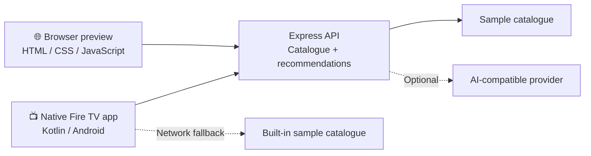

<div align="center">


<br/>

### Your next great watch, without the endless scroll.

**WatchWise TV** is a TV-first discovery experience built around a native Kotlin/Android app for Fire TV and a browser preview powered by a shared Node.js API.

<p>
  <a href="https://watchwise-fire-tv.vercel.app/"><strong>↗ Open the live preview</strong></a>
  &nbsp;·&nbsp;
  <a href="docs/fire-tv-demo-guide.md">Fire TV demo guide</a>
  &nbsp;·&nbsp;
  <a href="#-get-started">Get started</a>
</p>

<p>
  
  
  
  
</p>

> **Project status:** This is an actively developed demo. Build success, end-to-end browser behavior, and final Fire TV device/simulator compatibility still need to be verified. The banner is an original project illustration, not a screenshot of a validated device run.

</div>

---

## ✦ The idea

TV time should feel like choosing—not searching.

WatchWise brings discovery controls into one calm, remote-friendly interface: explore a catalogue, narrow it by genre, save favorites, open a title, and ask for a few relevant picks. A shared API powers the native app and the browser preview, while a built-in sample catalogue helps the interface remain useful when the backend cannot be reached.

<table>
<tr>
<td width="50%" valign="top">

### 🎮 Made for the couch

- Large, focus-visible controls
- D-pad-friendly navigation patterns
- Search and genre filtering
- Favorites stored locally
- Details and video playback flow

</td>
<td width="50%" valign="top">

### ✨ Discovery with a fallback

- Shared catalogue API
- Short-list recommendations
- Deterministic recommendations without an AI key
- Optional server-side AI provider
- Built-in sample catalogue for offline/demo fallback

</td>
</tr>
</table>

## 🧭 Experience map

| Step | What happens |
|---|---|
| **Discover** | Browse titles from the catalogue or built-in demo data. |
| **Narrow it down** | Search by title, genre, or description and filter by category. |
| **Keep it close** | Save favorites locally for quick access. |
| **Get a nudge** | Request recommendations based on genre and duration preferences. |
| **Press play** | Open the player and try the configured sample stream. |

## 🏗️ How it fits together



The API is designed to return local recommendations when no AI provider is configured or the AI request fails. Provider credentials belong on the backend—never in the Android client.

## 🧰 Tech stack

| Layer | Technology |
|---|---|
| Native TV client | Kotlin, Android |
| Playback | AndroidX Media3 |
| Web preview | HTML, CSS, JavaScript |
| API | Node.js 18+, Express |
| HTTP/security middleware | CORS, Helmet |
| Optional recommendations | OpenAI-compatible Chat Completions API |
| Hosting | Vercel configuration included |
| Automation | GitHub Actions Android build workflow |

## 📁 Repository tour

```text
watchwise-fire-tv/
├── app/                         # Native Android / Fire TV client
├── backend/
│   ├── api/                     # Vercel serverless API entry points
│   ├── public/
│   │   └── index.html           # Responsive browser preview
│   ├── src/
│   │   ├── server.js            # Express routes and recommendation logic
│   │   └── catalogue.js         # Demo catalogue
│   ├── .env.example             # Backend configuration template
│   └── package.json
├── docs/
│   ├── watchwise-banner.svg     # Original README artwork
│   └── fire-tv-demo-guide.md    # Build, testing, and demo plan
├── .github/workflows/           # Android build workflow
├── LICENSE
└── README.md
```

## 🚀 Get started

### 1. Try the browser preview

Open **[watchwise-fire-tv.vercel.app](https://watchwise-fire-tv.vercel.app/)**.

The preview is intended to demonstrate catalogue browsing, search, genre filters, favorites, recommendations, and a video modal. If the deployed site is still loading indefinitely, the deployment or API path needs to be checked; a successful deployment status alone does not prove the app works end-to-end.

### 2. Run the backend locally

Requirements: **Node.js 18+** and npm.

```bash
cd backend
npm install
cp .env.example .env
npm start
```

On Windows PowerShell, use:

```powershell
Copy-Item .env.example .env
```

The server starts on port `3000` by default. Check the health route and catalogue:

```bash
curl http://localhost:3000/health
curl http://localhost:3000/api/titles
curl http://localhost:3000/api/genres
```

Request recommendations:

```bash
curl -X POST http://localhost:3000/api/recommendations \
  -H "Content-Type: application/json" \
  -d '{"genres":["Family","Adventure"],"maxDurationMinutes":15,"language":"English"}'
```

### 3. Build the Android app

1. Install Android Studio and a compatible JDK 17.
2. Install Android SDK Platform 35 and the required Build Tools.
3. Open the repository root in Android Studio and allow Gradle sync.
4. Build the `app` configuration, or use Gradle 8.9 and run:

   ```bash
   gradle assembleDebug
   ```

5. The expected debug APK path is `app/build/outputs/apk/debug/app-debug.apk`.

A GitHub Actions workflow attempts the debug build on pushes and pull requests. If it succeeds, download the `watchwise-tv-debug-apk` artifact from the workflow run.

> A generic Android emulator is useful for development, but it does not establish Fire TV platform compatibility. Follow the [Fire TV demo guide](docs/fire-tv-demo-guide.md) for target-device testing.

## 🔌 API quick reference

| Method | Endpoint | Purpose |
|---|---|---|
| `GET` | `/health` | Health status and AI configuration flag |
| `GET` | `/api/titles` | List titles; optional `genre` and `q` query filters |
| `GET` | `/api/titles/:id` | Fetch a title by ID |
| `GET` | `/api/genres` | List catalogue genres |
| `POST` | `/api/recommendations` | Return recommendations from local logic or optional AI |
| `GET` | `/api-info` | Describe available API endpoints |

For the deployed routes, replace `http://localhost:3000` with the base URL `https://watchwise-fire-tv.vercel.app`.

## 🧠 Optional AI recommendations

Without an AI key, recommendations use deterministic local logic. To enable an OpenAI-compatible provider, set the following in `backend/.env`:

```env
AI_API_KEY=your_provider_key
AI_BASE_URL=https://api.openai.com/v1
AI_MODEL=gpt-4o-mini
```

Use a provider endpoint/model you are authorized to access. **Never commit `.env`, put secrets in the browser, or embed an AI key in the Android app.** If AI is not configured, the app should still be able to use local recommendations.

## 🎬 Demo media

The catalogue uses public sample video URLs for development. These URLs can change, become unavailable, or have usage restrictions. Verify playback and the applicable licensing/attribution terms before a public demo or distribution. Replace demo URLs with media you own or have permission to stream.

## ✅ Before calling it demo-ready

- [ ] Install/build the Android app successfully.
- [ ] Verify it launches on the intended Fire TV device or accepted simulator.
- [ ] Navigate the interface using only the remote.
- [ ] Test search, genres, favorites, Details, Back, and focus visibility.
- [ ] Test playback, pause, seek, exit, and the failure state.
- [ ] Confirm `/health`, `/api/titles`, and `/api/recommendations` work.
- [ ] Test both local recommendation fallback and AI mode if configured.
- [ ] Verify the browser preview in a clean browser session.
- [ ] Record the actual target-platform demo and include it in the submission if required.

## 🗺️ Roadmap

- [x] Shared catalogue and recommendation API
- [x] Browser preview for quick review
- [x] Local recommendation fallback
- [x] Favorites and catalogue filters in the browser preview
- [ ] Confirm stable production deployment and API routing
- [ ] Complete native build and remote-only device testing
- [ ] Capture real screenshots from the verified target device
- [ ] Record a concise end-to-end demo

## 🤝 Contributing

1. Fork the repository and create a focused feature branch.
2. Keep secrets and personal credentials out of commits.
3. Test both the browser experience and API routes for changes that affect discovery.
4. For native UI changes, check remote navigation, focus visibility, and Back behavior.
5. Open a pull request with a concise summary and test evidence.

## 📄 License

Released under the [MIT License](LICENSE).

---

<div align="center">

**WatchWise TV** · Find the next thing worth watching.

<sub>Built as a TV-first discovery prototype. Please verify build, playback, deployment, and target-device behavior before presenting it as production-ready.</sub>

</div>
