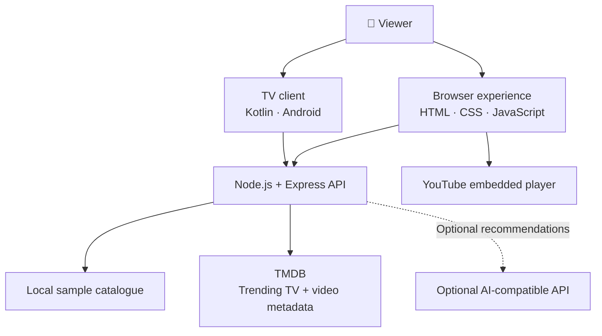

<!-- WatchWise TV | polished project showcase -->
<div align="center">


# 🎬 WATCHWISE TV

### Less scrolling. More watching.

**Your next favorite story starts here.**  
Discover movies and series, explore trending shows, find trailers, and keep your watchlist close — all in one streamlined experience.

<br/>

<a href="https://watchwise-fire-tv.vercel.app/"></a>
<a href="#-getting-started"></a>

<br/><br/>


</div>

---

## ✨ The experience

Choosing what to watch should feel exciting, not exhausting. WatchWise brings discovery into one focused interface, pairing a curated catalogue with live trending data and quick trailer access.

<table>
  <tr>
    <td width="50%">
      <h3>🔥 Trending now</h3>
      Explore TV series trending on TMDB, with artwork, ratings, dates, and descriptions.
    </td>
    <td width="50%">
      <h3>▶️ Trailer previews</h3>
      Find available YouTube trailers and watch them in an embedded player.
    </td>
  </tr>
  <tr>
    <td width="50%">
      <h3>🔎 Smarter discovery</h3>
      Search titles and narrow the catalogue by genre or industry.
    </td>
    <td width="50%">
      <h3>❤️ Your favorites</h3>
      Save titles locally in your browser for easy access later.
    </td>
  </tr>
  <tr>
    <td width="50%">
      <h3>🧠 Recommendations</h3>
      Get suggestions based on preferences, with a local fallback when AI is not configured.
    </td>
    <td width="50%">
      <h3>📺 Streaming shortcuts</h3>
      Jump to external streaming providers from the discovery flow.
    </td>
  </tr>
</table>

## 🖼️ A little movie-night inspiration

<div align="center">
  
  
</div>

<div align="center">
  
  
  <p><sub>Illustrative cinema and entertainment imagery, loaded from Unsplash. These are not screenshots of the WatchWise interface.</sub></p>
</div>

> **Want to showcase the real UI?** Add your app screenshots to `docs/screenshots/` and replace these illustrative images with repository-relative image paths.

## 🧩 How it fits together



## 🛠️ Built with

| Layer | Technologies |
|---|---|
| Web interface | HTML, CSS, JavaScript |
| Backend API | Node.js 18+, Express |
| Middleware | Helmet, CORS |
| Trending and trailer metadata | TMDB API |
| Trailer playback | YouTube embedded player |
| TV client | Kotlin, Android, AndroidX Media3 |
| Deployment configuration | Vercel |
| Automation | GitHub Actions |

## 🚀 Getting started

### Prerequisites

- Node.js 18 or newer
- npm
- A TMDB API key for live trending series and trailer lookup
- Optional AI-compatible API credentials for AI-assisted recommendations

### 1. Install dependencies

```bash
cd backend
npm install
```

### 2. Configure environment variables

Copy the template:

```bash
cp .env.example .env
```

On Windows PowerShell:

```powershell
Copy-Item .env.example .env
```

Edit `backend/.env`:

```dotenv
TMDB_API_KEY=your_tmdb_api_key

# Optional
AI_API_KEY=your_ai_api_key
# AI_BASE_URL=https://api.openai.com/v1
# AI_MODEL=gpt-4o-mini
```

> 🔐 **Security tip:** Never commit real API keys. Add production credentials through your deployment platform's environment-variable settings.

### 3. Start WatchWise

```bash
npm start
```

Open **[http://localhost:3000](http://localhost:3000)** in your browser.

### 4. Check the API

```bash
curl http://localhost:3000/health
curl http://localhost:3000/api/titles
curl http://localhost:3000/api/genres
curl http://localhost:3000/api/trending-series
```

Find a trailer for a TMDB TV-series ID:

```bash
curl http://localhost:3000/api/trending-series/SERIES_ID/trailer
```

Example recommendation request:

```bash
curl -X POST http://localhost:3000/api/recommendations \
  -H "Content-Type: application/json" \
  -d '{"genres":["Family","Adventure"],"maxDurationMinutes":15,"language":"English"}'
```

### 5. Build the Android / Fire TV client

1. Install Android Studio and JDK 17.
2. Install the SDK components required by the project.
3. Open the repository root in Android Studio and sync Gradle.
4. Build the debug variant, or run `gradle assembleDebug` if Gradle is available.
5. Test navigation and playback on your target device. A generic Android build does not confirm compatibility with every Fire TV model.

## 🔌 API at a glance

| Method | Endpoint | Purpose |
|---|---|---|
| `GET` | `/health` | Health and configuration status |
| `GET` | `/api/titles` | Browse catalogue titles; supports optional filters |
| `GET` | `/api/titles/:id` | Retrieve a title |
| `GET` | `/api/genres` | List available genres |
| `GET` | `/api/trending-series` | Get trending TV series from TMDB |
| `GET` | `/api/trending-series/:id/trailer` | Find a YouTube trailer for a TMDB TV-series ID |
| `POST` | `/api/recommendations` | Get local or optional AI-assisted suggestions |
| `GET` | `/api-info` | Describe API endpoints |

## 📌 Good to know

- Trending data depends on TMDB availability and valid server-side credentials.
- Some YouTube videos cannot be embedded or may not have trailer metadata.
- WatchWise embeds YouTube videos; it does not download or rehost them.
- Streaming shortcuts open external services; playback and regional availability are controlled by those providers.
- Sample catalogue content can be used as a fallback when the API is unavailable.

## 🗂️ Project structure

```text
watchwise-fire-tv/
├── app/                         # Android / Fire TV client
├── backend/
│   ├── api/                     # Vercel serverless entry points
│   ├── public/
│   │   └── index.html           # Browser UI
│   ├── src/
│   │   ├── server.js            # Express routes
│   │   └── catalogue.js         # Sample catalogue
│   ├── .env.example
│   └── package.json
├── docs/
│   ├── screenshots/             # Optional real UI screenshots
│   ├── watchwise-banner.svg
│   └── fire-tv-demo-guide.md
├── .github/workflows/
├── LICENSE
└── README.md
```

## 🗺️ Roadmap

- [x] Catalogue search and filters
- [x] Favorites
- [x] Trending TV-series section
- [x] YouTube trailer lookup and embedded playback
- [x] Local recommendation fallback
- [ ] Add real UI screenshots to the gallery
- [ ] Add automated API and player-flow tests
- [ ] Verify live trailer flows and target-device navigation

## 🤝 Contributing

Ideas and pull requests are welcome. For bugs, include clear reproduction steps. Please do not commit secrets, local environment files, build outputs, or copyrighted media.

## 📄 License

Released under the [MIT License](LICENSE), subject to the terms that apply to third-party services and assets.

---

<div align="center">

### 🍿 Less scrolling. More watching.

**Discover something worth watching with WatchWise TV.**

<a href="https://watchwise-fire-tv.vercel.app/"><strong>Launch WatchWise ↗</strong></a>

</div>
